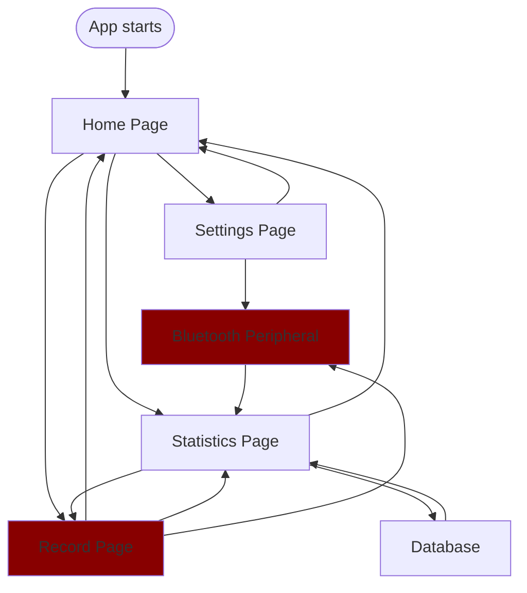

# Disc-Sense

This repository contains the Flutter/Dart project for the Disc-sense application UI. The purpose of the project is to provide an automatic solution for filming games and tracking stats to support engagement and communication from the sideline.

## Architectural Breakdown
### External Interface

The application UI serves as the external interface between the user and software. Information is shared with the persistent state through functions(in ./disc_sense/lib/game_model.dart) that create/save/delete entries.

### Persistent State

This project uses ObjectBox to store entries(games) in the app-file space so that the list of games and all the relevant game information is persistent.

### Internal Systems

Image processing and computer vision are handled outside of the main application. However, data is streamed from the external device to the application/UI through bluetooth using the FlutterBluePlus package.

### Information Handling
A rudimentary structure for error handling while scanning for the correct service and characteristics is in place, however it was not possible at this point to fully test all bluetooth capabilities. FlutterBluePlus handles corrupt data through 24-bit CRC, but further basic value-checks were also put in place to flag faulty information.

## Software Flowchart


Note: data is exchanged with the database and bluetooth peripheral, but connections between pages denote UI paths

## Main UI states

- **Home:** Entry point with shortcuts to Stats, Record, and Settings.
- **Stats:** Creates new games, edits saved games, deletes selected games, and
  stores game/player data.
- **Record:** Toggles between ready and recording states. The camera preview
  and camera switching are currently placeholders.
- **Settings:** Provides cloud-storage input, privacy headings, Bluetooth
  connection, and a save-settings action.

## Building and testing

To build the application into an executable or apk file, the relevant SDKs must be installed. 
Use the following command to determine what SDKs are missing:
```bash
flutter doctor
```
Once the relevant SDKs have been installed, run:
```bash
flutter build <target>
```


To test changes through simulation/emulation, from the project directory, run: 
```bash
flutter devices
```
to view native devices available to run the app.
Then run the following command with "native-device-id" being a device that is not web-based
```bash
flutter run -d <native-device-id>
```

# Documented Bugs
## Failure after incorporating ObjectBox's Dart package
The project was using a native FFI-base implementation which imported 'dart:ffi' which is not supported by chrome/web builds.
Since web-browsers are not a main target of the app, the build target was changed to Windows, which worked but required installation
of the Visual Studio toolchain for developing Windows apps (found at https://visualstudio.microsoft.com/downloads/). Android
development requires the Android SDK (found at https://developer.android.com/studio/index.html).

## Missing Features
The application contains a basic library for using the FlutterBluePlus package to communicate with an external device via BLE, but testing was not conducted due to needing both a device to run the application on and another device to connect to via Bluetooth (raspberry pi).

The feature for recording and storing video was not implemented yet. The user would have to connect a personal cloud storage option (like google cloud or google drive) to upload recorded videos to; this would require permissions and a temporary local storage for very large files, so video recording was excluded from the scope of the Pre-Alpha Build. 
